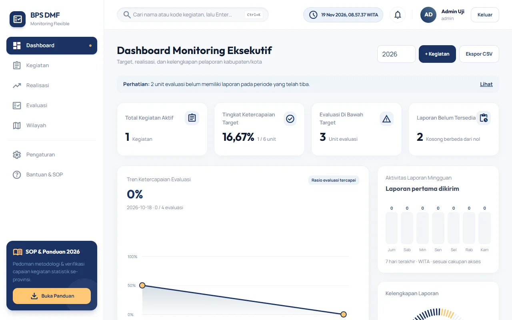

# BPS Dashboard Monitoring Flexible

> [!NOTE]
> **Live Application:** [`https://bps-dashflex.pinnhost.my.id/`](https://bps-dashflex.pinnhost.my.id/)

Platform pemantauan capaian kegiatan statistik multi-wilayah untuk BPS. **Vue 3 + TypeScript** menangani antarmuka reaktif dan grafik tren; **Laravel 13** menangani autentikasi sesi, cakupan peran, idempotensi batch, snapshot resmi berversi, serta audit trail.



```text
[Admin / PJK] ──► Konfigurasi Kegiatan & Jadwal (Harian / Mingguan / Bulanan / Triwulanan)
       │
       ▼
[Operator Provinsi] ──► Batch Input (≤20 baris, idempotent key) ──► [Snapshot Resmi Berversi]
                                                                            │
                                                      ┌─────────────────────┴─────────────────────┐
                                                      ▼                                           ▼
                                          [Tiket Koreksi & Approval]                 [Ekspor CSV & Audit Log]
```

### Arsitektur & Stack

| Komponen | Teknologi | Fungsi |
| :--- | :--- | :--- |
| **Frontend** | Vue 3.5, TypeScript, Tailwind CSS v4 | Dashboard eksekutif, matriks wilayah, gauge kelengkapan |
| **Backend API** | Laravel 13, PHP 8.4+ | Sesi & CSRF, otorisasi peran, snapshot & tiket revisi |
| **Database** | MySQL (Production) · SQLite (Local/Test) | Penyimpanan realisasi desimal presisi & log perubahan |
| **Verification** | PHPUnit + Playwright Browser E2E | Validasi kontrak API, alur realisasi, & layout responsif |

<details>
<summary><b>Menjalankan Lokal, Test &amp; Build Rilis</b></summary>

```bash
npm ci
composer install --working-dir=backend
cp backend/.env.example backend/.env
cd backend && php artisan key:generate && php artisan migrate
php artisan dmf:admin admin@dmf.test --name="Administrator"
php artisan dmf:demo
```

Build SPA & jalankan server lokal:

```bash
npm run build
php artisan serve --host=127.0.0.1 --port=8000
```

Verifikasi Windows: `./scripts/check.ps1 -Browser` · Dokumen lengkap tersedia di [`docs/`](docs/operations/production.md).

</details>
